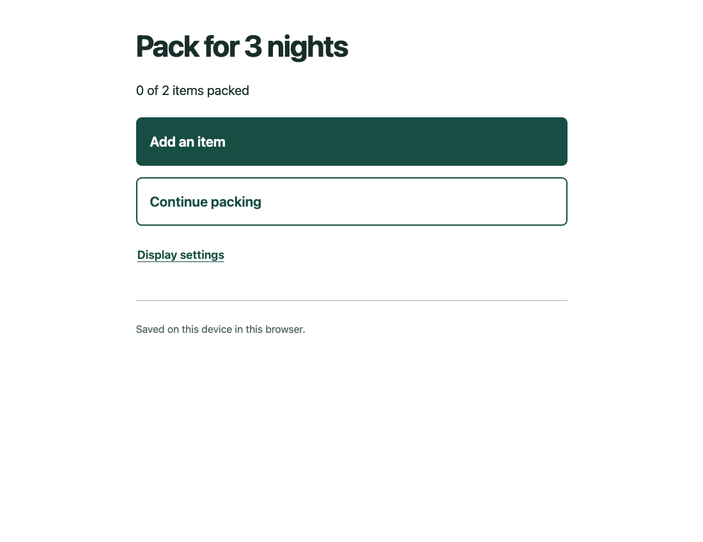

# Plain Steps

Reusable AI skills for keeping the meaning of rough requests and building apps with a clear next action.

Plain Steps has two connected jobs: help an assistant understand what someone actually asked, then help it build an app the person can use. A concise reply alone does not make the resulting app understandable.

**Version 0.1.0:** experimental source release. [Verification](plugins/plain-steps/docs/VERIFICATION.md) records 12 local app checks and six interpretation fixtures. The fixtures did not demonstrate improved requirement retention. Native automatic activation, matched baseline-app execution, screen-reader and participant validation remain open. This is a source/marketplace release, separate from an OpenAI directory listing.

## Start with your own words

Select Plain Steps in a supported host and describe the work normally. No diagnosis, profile or rewritten prompt is needed.

- “Help me keep the meaning of this rough request.”
- “Build a clear app from this goal.”

The package contains two focused skills, [Keep the meaning](plugins/plain-steps/skills/keep-the-meaning/SKILL.md) and [Build clear apps](plugins/plain-steps/skills/build-clear-apps/SKILL.md). You can use either independently. The host decides whether to activate a skill; selecting or naming the skill helps make that choice explicit.

## Install from a local checkout

From this repository's root:

```sh
codex plugin marketplace add .
```

Then run `codex plugin add plain-steps@plain-steps-public`, or choose **Plain Steps** from this marketplace in the desktop host. Follow any host-required trust or permission prompts. Registration adds a marketplace source; it does not by itself prove installation or skill activation. A desktop restart may be required for discovery.

The public release uses a tag-pinned Git source:

```sh
codex plugin marketplace add CreeleyDigitalSystems/plain-steps --ref v0.1.0
```

Check the actual published tag before installing. Local registration and installation were verified; remote-source readback and install are recorded separately in the release receipt. See the [official package guide](https://developers.openai.com/plugins/build/plugins).

## What is included

- [Plugin guide](plugins/plain-steps/README.md): usage and everyday preferences.
- [Architecture](plugins/plain-steps/docs/ARCHITECTURE.md): how meaning and build guidance connect.
- [Research](plugins/plain-steps/docs/RESEARCH.md): evidence, limits and source links.
- [Source-to-test matrix](plugins/plain-steps/docs/source-to-test.csv): the remedies and their acceptance checks.
- [Privacy](plugins/plain-steps/PRIVACY.md), [limitations](plugins/plain-steps/LIMITATIONS.md), [licence](plugins/plain-steps/LICENSE) and [release notes](plugins/plain-steps/CHANGELOG.md).

The representative example is a fictional three-night packing app. It demonstrates a small everyday surface with deeper detail available when wanted. Its exact test results belong in the release evidence, not in a promise about every app an AI might build.

## Cost and scope

The package is offered under the MIT licence with no package charge. It does not supply a model, subscription, API credits or paid hosting. Your chosen AI host may have charges, usage limits and its own privacy rules. No new account or key is required by these skills.

Plain Steps is instruction and example source, not a clinical service or a guarantee of accessibility. Desktop, web and mobile availability must be checked separately. A public source release is distinct from an OpenAI directory listing. This project is independently published by Creeley Digital Systems and does not imply platform endorsement.

## Working example

This is the bundled offline example, not a panel inside the AI host.


